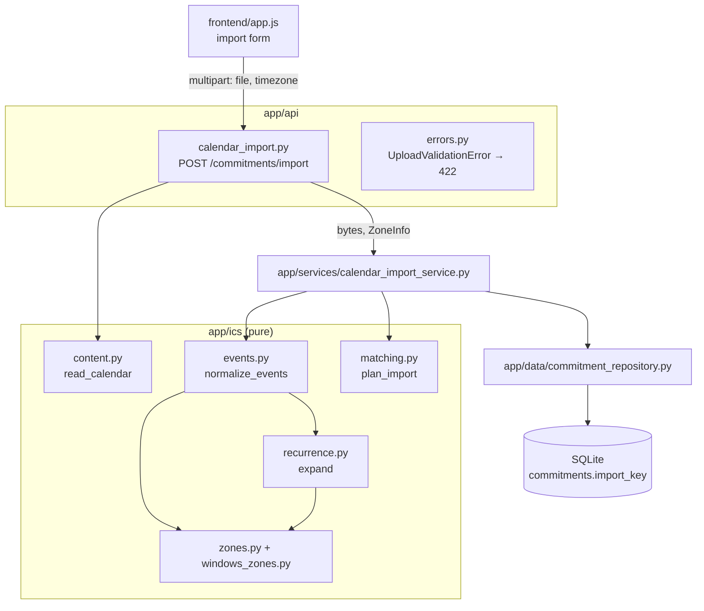

# Design Document: calendar-import

## Overview

This design adds `.ics` upload to FLOWLY. A student picks a calendar file in the Commitments
section; the browser sends it with its IANA time zone; the server turns the file's events into
Commitments with `source = ics_import`, matching earlier imports by an import key so re-importing
updates rather than duplicates. It implements `requirements.md` in this folder and builds on the
MVP design in `docs/design.md`.

The work splits along the MVP's existing seams:

- A new pure package, `app/ics/`, does all ICS work: reading content lines, resolving time zones,
  expanding recurrences, building import records, and deciding creates/updates. It has no
  database, clock, network, or FastAPI imports, so it is tested with hypothesis the way
  `app/planning/` is.
- A new service and router wire the core to the existing `CommitmentRepository`, error envelope,
  and frontend.
- Existing endpoints, schemas, and tests keep their behavior.

### Key decisions

| Topic | Decision | Section |
|---|---|---|
| Old recurring series | Expansion starts at the import window for every rule without `COUNT`. `COUNT` rules are expanded from `DTSTART`. A 200,000-date budget per file is the backstop for both. | §5 |
| Recurrence engine | A hand-written expander for the supported `RRULE` subset. `python-dateutil` is a test-only reference. | §5.1 |
| Windows zone names | Static table from **CLDR release 49** (published 2026-10-22, tag `release-49`): 142 default-territory entries, all present in `tzdata` 2026.5. | §4.4 |
| Zone data source | Zones load from the pinned `tzdata` package, never the OS, so rules match on every machine. | §4.4 |
| ICS parser | Hand-written content-line reader (no `icalendar` dependency). | §4.2 |
| Upload size limit | Enforced on the raw request stream before multipart parsing. | §3.2 |
| Endpoint | `POST /commitments/import` | §3.1 |

## 1. Architecture



### New and changed files

| Path | Change |
|---|---|
| `app/ics/__init__.py` | New. Re-exports the public core API. |
| `app/ics/types.py` | New. Dataclasses, `SkipReason`, `ImportLimits`, `InvalidCalendarError`. |
| `app/ics/content.py` | New. Bytes → component tree (`read_calendar`). |
| `app/ics/values.py` | New. DATE, DATE-TIME, DURATION, TEXT, and RRULE value parsing. |
| `app/ics/zones.py` | New. Zone loading from `tzdata`, `TZID` resolution, conversion helpers. |
| `app/ics/windows_zones.py` | New. Generated CLDR 49 Windows → IANA table. |
| `app/ics/recurrence.py` | New. `RRULE` expansion with window start and date budget. |
| `app/ics/events.py` | New. VEVENT → import records and skipped items (`normalize_events`). |
| `app/ics/matching.py` | New. Records + stored keys → create/update/unchanged plan (`plan_import`). |
| `app/services/calendar_import_service.py` | New. Orchestrates parse → match → persist. |
| `app/schemas/calendar_import.py` | New. `ImportSummary`, `SkippedItemRead`. |
| `app/api/calendar_import.py` | New. Router and upload reading. |
| `app/api/errors.py` | Add `UploadValidationError` and its handler. |
| `app/main.py` | Include the import router; call the schema check at startup. |
| `app/data/models.py` | Add `Commitment.import_key`. |
| `app/data/database.py` | Add `check_schema(engine)`. |
| `app/data/commitment_repository.py` | Add `get_by_import_keys`, `apply_import`. |
| `app/domain/enums.py` | Add `Source.ICS_IMPORT = "ics_import"`. |
| `app/schemas/commitment.py` | `CommitmentCreate` rejects any `source` other than `manual`. |
| `frontend/index.html`, `app.js`, `styles.css` | Import form, summary, "Imported" badge. |
| `README.md` | "Calendar import" section; architecture table row for `app/ics/`. |
| `requirements.txt` | Add `python-multipart`, `tzdata`, `python-dateutil` (pinned). |

`app/ics/` imports only the standard library (`datetime`, `zoneinfo`, `importlib.resources`,
`dataclasses`, `enum`, `re`) and the `tzdata` package's data files (Requirement 12.1–12.2).

## 2. Data Model Changes

### `Source` enum

```python
class Source(str, Enum):
    MANUAL = "manual"
    ICS_IMPORT = "ics_import"
```

### `Commitment.import_key`

```python
import_key: Mapped[str | None] = mapped_column(nullable=True, unique=True, default=None)
```

- `NULL` for manual commitments. SQLite and PostgreSQL both allow many `NULL`s in a unique column,
  so uniqueness applies only to imported rows (Requirement 5.2).
- Not added to `CommitmentRead`, so existing responses are unchanged (Requirement 16.2). The
  frontend identifies imported rows by `source`, which is already in the response.
- `CommitmentUpdate` has no `import_key` or `source` field and the service only sets supplied
  fields, so `PUT /commitments/{id}` keeps both (Requirement 9.5) with no code change.

### Import key format

| Event kind | Key |
|---|---|
| Non-recurring | `S|<uid>` |
| Occurrence of a zoned series | `R|<YYYYMMDDTHHMMSSZ>|<uid>`, the UTC instant of the original start |
| Occurrence of a floating series | `R|<YYYYMMDDTHHMMSS>|<uid>`, the original wall-clock start |

The prefix and the fixed-format timestamp come before the UID, so a key always parses one way even
when a UID itself contains `|`. Keys never depend on the upload zone (Requirement 5.4).

### Database upgrade

`create_all` creates missing tables but never adds columns. An existing `flowly.db` therefore lacks
`import_key`, and every commitment query would fail because the ORM selects that column. §7 adds a
startup check that fails fast with instructions; the README documents deleting `flowly.db`
(Requirement 14, 17.7). No migration tool is added.

## 3. API

### 3.1 Endpoint

`POST /commitments/import`, `multipart/form-data`:

| Field | Type | Notes |
|---|---|---|
| `file` | file | The `.ics` file. Name and content type are ignored (Requirement 1.4). |
| `timezone` | text | IANA zone name from the browser. |

Responses:

| Case | Code | Body |
|---|---|---|
| Import ran (even if all events were skipped) | `200` | `ImportSummary` |
| Request or file rejected | `422` | Error envelope, `type: "validation_error"`, details on `file` and/or `timezone` |

Routing: the existing commitments router has `/{commitment_id}` routes for GET, PUT, and DELETE
only. Starlette keeps searching after a path-only match, so `POST /commitments/import` reaches the
new route whatever the include order. `GET /commitments/import` still returns the same `422` as
before (the id fails integer validation), so existing behavior is unchanged. The import router is
included before the commitments router to make the intent obvious.

The route declares its multipart body through `openapi_extra` so `/docs` shows both fields, because
the handler reads the body itself (§3.2) instead of using FastAPI `File`/`Form` parameters.

### 3.2 Reading the upload

FastAPI's `File`/`Form` parameters parse the whole body before the handler runs, and Starlette's
`max_part_size` limit does not apply to file parts. To stop reading at the limit
(Requirement 2.4), the handler reads the raw stream itself:

1. **Content type.** If the request is not `multipart/form-data`, reject: `file` — "Upload the
   calendar as multipart/form-data with a 'file' field."
2. **Declared length.** `MAX_BODY = 5,242,880 + 65,536` bytes (file limit plus room for multipart
   headers and the `timezone` field). If `Content-Length` exceeds `MAX_BODY`, reject without
   reading: `file` — "The file must be at most 5 MiB."
3. **Streamed length.** Read `request.stream()` into a buffer, counting bytes. As soon as the count
   exceeds `MAX_BODY`, stop reading and reject the same way. This covers chunked uploads with no
   `Content-Length`. Per Requirement 2.7, the `timezone` field is not inspected in this case.
4. **Multipart parse.** Build a second `Request` over the same scope whose `receive` replays the
   buffer, then call `await replay.form(max_files=1, max_fields=1, max_part_size=1024)`. A
   `MultiPartException` (malformed body, extra fields, or a second file) is rejected on `file`.
5. **Field checks.** All of these are collected into one details list:
   - `timezone` missing or blank: "timezone is required."
   - `timezone` not in the `tzdata` zone list: "'<value>' is not a recognized IANA time zone."
   - `file` missing or not a file part: "file is required."
   - File larger than 5,242,880 bytes: "The file must be at most 5 MiB."
   - File structure (§4.2) invalid: the `InvalidCalendarError` issue, for example "The file is not
     valid UTF-8 text." This check runs even when `timezone` is invalid, so both details are
     reported (Requirement 2.7).
6. If any detail was collected, raise `UploadValidationError(details)`. Otherwise hand the document
   and zone to the service.

The parse and persist steps are CPU- and DB-bound, so the async handler runs them with
`run_in_threadpool`. The session from `get_db` is used in that one worker thread, the same way the
existing sync endpoints use it.

### 3.3 Response schema (`app/schemas/calendar_import.py`)

```python
class SkippedItemRead(BaseModel):
    uid: str | None
    title: str | None
    start_time: datetime | None      # naive local time in the upload zone
    reason: SkipReason               # str enum from app.ics.types
    message: str
    count: int                       # 1, except the past_event aggregate

class ImportSummary(BaseModel):
    timezone: str
    created: int
    updated: int
    skipped: int                     # == sum(item.count for item in skipped_items)
    skipped_items: list[SkippedItemRead]
```

**Past-event aggregate** (Requirement 10.5). Past non-recurring events can number in the
thousands for a calendar exported with years of history, so they are not listed one by one.
`skipped_items` gets at most one entry with `reason: "past_event"`, `count: N`, and `uid`, `title`,
and `start_time` all `null`. That replaces what could be thousands of entries with one, while
`skipped` still adds up. Other reasons keep one entry per item with
`count: 1`, so their details stay visible. The aggregate comes after the other parser skips and
before the `unchanged` entries.

Example:

```json
{
  "timezone": "America/Toronto",
  "created": 14,
  "updated": 2,
  "skipped": 315,
  "skipped_items": [
    {"uid": "abc@google.com", "title": "Reading week", "start_time": null,
     "reason": "all_day", "message": "All-day events are not imported.", "count": 1},
    {"uid": "x1@outlook", "title": "Team sync", "start_time": null,
     "reason": "unknown_timezone",
     "message": "Time zone '(UTC-05:00) Eastern Time (US & Canada)' is not recognized.",
     "count": 1},
    {"uid": null, "title": null, "start_time": null, "reason": "past_event",
     "message": "312 events ended before 2026-10-27 00:00 and were not imported.",
     "count": 312},
    {"uid": "c9@google.com", "title": "CS 101", "start_time": "2026-11-02T09:00:00",
     "reason": "unchanged", "message": "Already up to date.", "count": 1}
  ]
}
```

### 3.4 Error mapping

`app/api/errors.py` gains:

```python
class UploadValidationError(Exception):
    def __init__(self, details: list[dict[str, str]]): ...
```

Its handler returns `error_response(422, VALIDATION_ERROR, "Request validation failed", details)`,
the same envelope and message as every other validation failure. `InvalidCalendarError` from the
core (structure, record limit, date budget) is always converted to `UploadValidationError` with
`field: "file"` before it leaves the API layer.

## 4. Parsing Core: Reading and Normalizing

### 4.1 Public interface (`app/ics/types.py`)

```python
class SkipReason(str, Enum):
    UNCHANGED = "unchanged"; DUPLICATE = "duplicate"; MISSING_UID = "missing_uid"
    MISSING_START = "missing_start"; INVALID_INTERVAL = "invalid_interval"; ALL_DAY = "all_day"
    CANCELLED = "cancelled"; UNKNOWN_TIMEZONE = "unknown_timezone"; DST_OVERLAP = "dst_overlap"
    UNSUPPORTED_RECURRENCE = "unsupported_recurrence"; OUTSIDE_WINDOW = "outside_window"
    PAST_EVENT = "past_event"; MALFORMED_EVENT = "malformed_event"

@dataclass(frozen=True)
class ImportLimits:
    max_records: int = 2_000
    max_examined_dates: int = 200_000
    window_days: int = 180

@dataclass(frozen=True)
class ImportRecord:
    import_key: str
    uid: str
    title: str
    start: datetime          # naive local, upload zone
    end: datetime

@dataclass(frozen=True)
class SkippedItem:
    uid: str | None
    title: str | None
    start: datetime | None
    reason: SkipReason
    message: str
    count: int = 1           # > 1 only for the past_event aggregate

@dataclass(frozen=True)
class ParseResult:
    records: tuple[ImportRecord, ...]
    skipped: tuple[SkippedItem, ...]

class InvalidCalendarError(ValueError):
    issue: str               # becomes the envelope detail's "issue"
```

Entry points:

```python
def read_calendar(content: bytes) -> CalendarDocument            # content.py
def normalize_events(doc: CalendarDocument, upload_zone: ZoneInfo,
                     reference: datetime, limits: ImportLimits = ImportLimits()) -> ParseResult
def plan_import(records: Sequence[ImportRecord],
                stored: Mapping[str, StoredImport]) -> ImportPlan  # matching.py
def resolve_upload_zone(name: str) -> ZoneInfo | None              # zones.py
```

`reference` must be timezone-aware; a naive value raises `ValueError` (Requirement 12.2).

### 4.2 Reading content lines (`content.py`)

1. Strip one leading UTF-8 BOM, then decode strictly as UTF-8. Failure → `InvalidCalendarError`
   "The file is not valid UTF-8 text."
2. Empty or whitespace-only → "The file is empty."
3. Normalize `\r\n` to `\n` and split into lines. A line starting with a space or tab continues the
   previous line with that one character removed (RFC 5545 §3.1). A continuation on the first line
   is invalid.
4. Tokenize each logical line as `NAME *(";" PARAM) ":" VALUE`:
   - Names and parameter names are case-insensitive and stored upper-case.
   - Parameter values are either `"quoted"` (no `"` inside) or unquoted text without `;`, `:`,
     `,` or `"`. Multiple values are comma-separated.
   - A line that doesn't match becomes a `BadLine` token carrying its physical line number.
5. Build the component tree from `BEGIN:`/`END:` lines:
   - `END` must match the innermost open `BEGIN`; otherwise → "BEGIN:<X> on line <n> has no
     matching END."
   - At the top level only `VCALENDAR` components and blank lines are allowed. At least one
     `VCALENDAR` is required ("The file has no BEGIN:VCALENDAR … END:VCALENDAR block."). More than
     one `VCALENDAR` is accepted; their events are processed in file order.
   - Nesting deeper than 8 levels is invalid.
   - A `BadLine` inside a `VEVENT` (including its `VALARM`s) marks that event malformed. Elsewhere
     it is ignored, since non-`VEVENT` content is not used.

`CalendarDocument` holds the `VEVENT` components in file order. Each event records its properties
as `(name, params, raw_value)` tuples, a `malformed` flag, and its starting line number. Other
components (`VTODO`, `VJOURNAL`, `VFREEBUSY`, `VTIMEZONE`, `VALARM`) are dropped
(Requirement 3.6, 8.8).

### 4.3 Values (`values.py`)

| Type | Accepted form | Notes |
|---|---|---|
| DATE-TIME | `YYYYMMDDTHHMMSS` with optional `Z` | Validated through `datetime(...)`. Second `60` is malformed. |
| DATE | `YYYYMMDD`, or any value with `VALUE=DATE` | Marks all-day when on `DTSTART`. |
| DURATION | `[+-]P nW` or `[+-]P [nD] [T [nH] [nM] [nS]]` | Weeks and days are nominal; H/M/S are exact (RFC 5545 §3.3.6). |
| TEXT | Any | `\\` → `\`, `\;` → `;`, `\,` → `,`, `\n`/`\N` → newline. |
| RRULE | `NAME=VALUE` parts separated by `;` | See §5.2 for validation. |

A value that fails to parse makes the event `malformed_event`.

### 4.4 Time zones (`zones.py`, `windows_zones.py`)

**Zone loading.** `zones.py` reads the key list from the `tzdata` package's `zones` file and builds
each zone with `ZoneInfo.from_file(files("tzdata.zoneinfo") / key, key=key)`, cached per key. It
never uses the OS zone database. On Windows `zoneinfo` would use `tzdata` anyway, but on Linux and
macOS it prefers system files, whose version can differ. Reading `tzdata` directly makes results
depend only on the pinned version (Requirement 4.8). I checked that `tzdata` provides this file
(597 keys in the installed 2023.3 copy).

**Upload zone.** `resolve_upload_zone(name)` returns the zone if `name` is exactly a key in that
list, else `None`. Windows names are not accepted here (Requirement 3.9).

**`TZID` resolution** (Requirement 3.3), done on the value after trimming whitespace and
surrounding `"`:

1. Exact match in the `tzdata` key list → that zone.
2. Lower-cased match in `WINDOWS_TO_IANA` → the mapped zone.
3. Otherwise unresolved → the event is skipped as `unknown_timezone`, with the raw `TZID` in the
   message.

The `UTC` value hits step 1 (`UTC` is an IANA key). `VTIMEZONE` blocks are never read
(Requirement 3.6).

**Windows table.** `windows_zones.py` is generated data:

```python
CLDR_RELEASE = "49"                    # published 2026-10-22, git tag release-49
CLDR_SOURCE = ("https://github.com/unicode-org/cldr/blob/release-49/"
               "common/supplemental/windowsZones.xml")
WINDOWS_ZONES_VERSION = "7e11800"      # otherVersion attribute in that file
WINDOWS_TO_IANA: dict[str, str] = {    # 142 entries, keys lower-cased
    "eastern standard time": "America/New_York",
    "gmt standard time": "Europe/London",
    "utc": "Etc/UTC",
    # ...
}
```

Facts I checked against the published files:

- CLDR 49 is listed as released on 2026-10-22 on the CLDR downloads page, with git tag
  `release-49`.
- The tagged `windowsZones.xml` has 142 `territory="001"` entries, with no two names equal when
  case is ignored, and each maps to exactly one zone.
- All 142 target zones exist in `tzdata` 2026.5, including legacy link names such as
  `America/Buenos_Aires` and `America/Godthab` (Requirement 3.8).

The module docstring records how to regenerate the table: download the file at the new tag, keep
the `territory="001"` rows, lower-case the names, and update the three constants. The regenerated
table must pass the unit test in §Testing that checks every target against the `tzdata` key list.

**Conversion** (Requirements 3.2, 3.10, 4.1–4.4):

```python
def to_local(wall: datetime, source: ZoneInfo | None, upload: ZoneInfo) -> datetime:
    if source is None:                       # floating: keep as written
        return wall
    aware = wall.replace(tzinfo=source, fold=0)
    return aware.astimezone(upload).replace(tzinfo=None)
```

`fold=0` gives exactly the RFC 5545 §3.3.5 rules, which I confirmed with `zoneinfo`:

- Gap: 02:30 `America/New_York` on 2026-03-08 → 07:30Z → 03:30 local (shifted forward by the gap).
- Fold: 01:30 `America/New_York` on 2026-11-01 → 05:30Z, the first (EDT) instant.

`Z` times use the `Etc/UTC` zone as `source`.

**Ends and durations** (Requirement 3.12–3.13):

- `DTEND` is converted on its own, so it may use a different zone from `DTSTART`.
- `DURATION` is applied in two steps: the nominal days and weeks are added to the start's wall
  time, then the result is resolved with `fold=0`, and the exact H/M/S part is added to that
  instant.
- If neither `DTEND` nor `DURATION` is present, the end equals the start, which produces
  `invalid_interval`.
- A floating start with a zoned end, or the reverse, is `malformed_event`.

**Window.** `window_start = datetime.combine(reference.astimezone(upload).date(), time.min)` and
`window_end = window_start + timedelta(days=limits.window_days)`. Both are naive local times. They
are used in two different ways:
- An occurrence of a recurring series is inside the window when
  `window_start <= start_local < window_end` (Requirement 6.2).
- A non-recurring event is past when `end_local <= window_start` (Requirement 6.13). Otherwise it is
  imported, with no upper bound from `window_end` (Requirement 6.12).

### 4.5 Event pipeline (`events.py`)

`normalize_events` first groups the events by UID into masters (no `RECURRENCE-ID`) and overrides
(with one). It then walks the masters and standalone events in file order. Each event goes through
the checks below in order, and the first check that fails produces the skip reason:

| # | Check | Skip reason |
|---|---|---|
| 1 | Event marked malformed by the reader | `malformed_event` |
| 2 | `UID` missing or blank | `missing_uid` |
| 3 | `STATUS:CANCELLED` | `cancelled` (one entry for a whole series) |
| 4 | `DTSTART` missing / unparseable | `missing_start` / `malformed_event` |
| 5 | `DTSTART` is a DATE | `all_day` |
| 6 | Any `TZID` on `DTSTART`, `DTEND`, `EXDATE`, `RDATE`, `RECURRENCE-ID` unresolved | `unknown_timezone` |
| 7 | End computed and compared before conversion (instants for zoned, wall times for floating) | `invalid_interval` |
| 8 | `RRULE` present → §5 (may yield `unsupported_recurrence`, `outside_window`, per-occurrence skips) | — |
| 9 | Convert start and end to upload-local | — |
| 10 | Non-recurring only: `end_local <= window_start` | `past_event` (counted, not listed; see below) |
| 11 | `end_local <= start_local` | `dst_overlap` |
| 12 | Key already emitted in this file | `duplicate` |
| 13 | Emit record; increment record count; over 2,000 → `InvalidCalendarError` | — |

**Past events** (Requirement 6.13). Row 10 comes right after conversion, so it uses the same
upload-local end that would be stored. It comes before `dst_overlap`, so an old event that crosses
a fold is counted as past instead of being listed. Events that fail rows 1–7 are still listed
under those reasons, because their end isn't known or valid yet. Row 10 increments a
`past_events` counter and emits nothing, so it never touches the record count in row 13. When
`normalize_events` finishes, a single `SkippedItem(reason=PAST_EVENT, count=past_events, …)` is
appended after the other parser skips if the counter is above zero. Its message names the cutoff
(`window_start`, formatted `YYYY-MM-DD HH:MM`).

**Title** (Requirement 8.1–8.3): the `SUMMARY` value is decoded and trimmed. A missing or empty
value becomes `Untitled event`. Titles longer than 200 characters are cut to 200 and then trimmed
again. The result always passes `_validate_title` from `app/schemas/commitment.py`.

**Skipped items** carry the UID, title, and upload-local start when those were already computed at
the point of the skip, and `None` otherwise.

**Order** (Requirement 10.8): records and parser skips follow file order. Within a series they
follow ascending original start. Unmatched overrides come right after their series. Overrides with
no master in the file are handled at their own position in the file. The `past_event` aggregate
comes last among parser skips.

## 5. Recurrence Expansion (`recurrence.py`)

This section settles the old-series open question.

### 5.1 Why not `python-dateutil` in the app

I measured `dateutil.rrule` 2.9.0.post0 on this machine:

| Rule | Result | Time |
|---|---|---|
| `FREQ=DAILY` from 1990-01-01 to 2027-05-01 | 13,634 dates | 0.05 s |
| `FREQ=DAILY;BYMONTH=2;BYMONTHDAY=30`, `UNTIL` one year out | 0 dates | **6.4 s** |

`dateutil` checks `UNTIL` only when a date matches. A rule that never matches keeps scanning until
year 9999, whatever `UNTIL` says. One such line in a file costs seconds; a hundred cost minutes.
Neither the 2,000-record limit nor an `UNTIL` bound stops it, so `dateutil` can't safely run on
uploaded rules. `recurring-ical-events` is built on `dateutil` and has the same problem. The
supported subset (Requirement 6.4) is small, so FLOWLY gets its own expander that walks recurrence
periods and stops at a period limit it controls. `dateutil` remains as a test oracle only
(Requirement 15.3; Property 9).

`python-dateutil` 3.0.0 was released on 2026-10-21. I pinned 2.9.0.post0 because it is installed
and stable, and its only use is as a reference in tests.

### 5.2 Rule validation

| Condition | Outcome |
|---|---|
| Syntax error, repeated part, `COUNT` and `UNTIL` together, `INTERVAL < 1`, `COUNT < 1`, out-of-range number | `malformed_event` |
| `FREQ` not in `DAILY`/`WEEKLY`/`MONTHLY`/`YEARLY`, or any part outside `FREQ`, `INTERVAL`, `COUNT`, `UNTIL`, `BYDAY`, `BYMONTHDAY`, `BYMONTH`, `WKST` | `unsupported_recurrence` |
| Ordinal `BYDAY` (e.g. `2MO`) with `DAILY` or `WEEKLY`; `BYMONTHDAY` with `WEEKLY` (not defined by RFC 5545) | `unsupported_recurrence` |
| More than one `RRULE`; `RDATE;VALUE=PERIOD`; override with `RANGE=THISANDFUTURE` | `unsupported_recurrence` (the last one skips only the override) |

Ranges: `BYMONTHDAY` ±1..31; `BYMONTH` 1..12. `BYDAY` ordinals are ±1..5 for `MONTHLY` and for
`YEARLY` with `BYMONTH`, and ±1..53 for `YEARLY` without it.

### 5.3 Options considered

| Option | Bounded? | Cost for a weekly class since 2015 | Handles `COUNT` | Verdict |
|---|---|---|---|---|
| A. Start at `DTSTART`, stop at window end | No. A rule that never matches still has to step through every period up to the window end. | ~600 periods, all wasted | Yes | Not enough alone |
| B. A only, plus a cap on dates examined | Yes | Uses up budget in proportion to the series' age, and long-running calendars can be rejected | Yes | Fallback only |
| C. Start at the window | Yes, about 190 periods per series at most | ~27 periods | **No.** `COUNT` counts from `DTSTART`, and the number of earlier matches can't be computed for every rule | Primary |
| **C for non-`COUNT` rules + A for `COUNT` rules + budget over all** | Yes | ~27 periods | Yes | **Chosen** |

Starting at the window makes the common case (classes and shifts with `UNTIL` or no end) cheap
however old the series is. `COUNT` rules have to be walked from `DTSTART`, but `COUNT` itself ends
them once enough dates match. The 200,000-date budget covers what's left: `COUNT` rules that match
rarely or never and start long ago, and files built to be expensive. It is generous for real
calendars. Each examined period costs 1 plus its candidates, so a weekly series started at the
window costs about 27 × 2 = 54. Fifty of them cost ~2,700. A daily `COUNT` series from 1990 costs
~27,000.

### 5.4 Algorithm

All work happens in the series' **source wall time** (naive), so a 09:00 class stays at 09:00 in
its own zone across DST changes (Requirement 6.3).

**Defaults from `DTSTART`** (RFC 5545 §3.3.10):
- `WEEKLY` without `BYDAY` → the weekday of `DTSTART`.
- `MONTHLY` without `BYDAY` and `BYMONTHDAY` → the day of the month of `DTSTART`.
- `YEARLY` with none of `BYMONTH`, `BYMONTHDAY`, `BYDAY` → the month and day of `DTSTART`.
- `YEARLY` with only `BYMONTH` → the day of the month of `DTSTART`.

The time of day always comes from `DTSTART`.

**Periods.** The period is a day, a week (starting on `WKST`, default `MO`), a month, or a year.
Period `p` is that many units after the period that contains `DTSTART`. Only periods where `p` is a
multiple of `INTERVAL` are examined.

**Candidates per period:**

| `FREQ` | Expand | Limit |
|---|---|---|
| `DAILY` | the day itself | `BYMONTH`, `BYMONTHDAY`, `BYDAY` |
| `WEEKLY` | days of the week in `BYDAY` | `BYMONTH` |
| `MONTHLY` | `BYMONTHDAY` days (negative from month end; invalid days such as the 31st in April are dropped); else `BYDAY` within the month (ordinal or all) | `BYMONTH`; `BYDAY` when `BYMONTHDAY` is present |
| `YEARLY` | `BYMONTH` months (or `DTSTART`'s); in each, `BYMONTHDAY` days, else `BYDAY` within the month. With no `BYMONTH`, `BYDAY` is expanded within the year | `BYDAY` when `BYMONTHDAY` is present |

**Expansion bounds** (in source wall time):

```text
lo = to_source_wall(window_start) - 2 days
hi = to_source_wall(window_end)   + 2 days
```

`to_source_wall` takes a naive upload-local time, resolves it with `fold=0`, and converts it to the
source zone. For floating series it returns the value unchanged. The 2-day margin is larger than
the largest gap between any two UTC offsets (26 hours), so no in-window occurrence is lost to zone
differences. The exact window test happens after conversion (§4.4).

**Start period:**
- *Without `COUNT`:* `p0` is the largest multiple of `INTERVAL` whose period starts at or before
  `lo`'s period, and never less than 0. Periods before `p0` contain only dates before `lo`, so
  skipping them changes nothing. Property 10 checks this.
- *With `COUNT`:* `p0 = 0`.

**Walk.** For `p = p0, p0 + INTERVAL, …`:
1. Stop if the period starts after `hi`, or after `UNTIL`.
2. Generate the candidates, sorted. Add `1 + len(candidates)` to the file-wide examined-date
   counter. If the counter exceeds 200,000, raise `InvalidCalendarError` ("Recurring events in
   this file need too much work to expand; the limit is 200,000 dates.").
3. For each candidate: skip it if it is before `DTSTART`; stop if it is after `UNTIL`; count it
   toward `COUNT` and stop once `COUNT` is reached; yield it if it is within `[lo, hi]`.

**`DTSTART` is always the first occurrence** (RFC 5545), even when it doesn't match the rule, and
it counts toward `COUNT`. With `p0 > 0` it lies before `lo`, so it doesn't matter. `dateutil` does
not do this, and the oracle test adjusts for it.

**`UNTIL`:**
- A `Z` or zoned `UNTIL` on a zoned series is converted to source wall time.
- A DATE `UNTIL` is inclusive through the end of that day.
- A floating `UNTIL` on a zoned series is read in the source zone.
- A zoned `UNTIL` on a floating series is `malformed_event`.

**`RDATE` / `EXDATE`:**
- `RDATE` DATE-TIME values are added to the set; each one counts as one examined date.
- `EXDATE` values remove originals with the same source wall time. A DATE `EXDATE` removes every
  original on that date.
- The set is de-duplicated and sorted.

**Occurrences.** For each original start `o` in ascending order:
1. The key is `R|stamp(o)|uid`.
2. If an override has the same key, it is consumed. The override's own skip checks apply first
   (`cancelled`, `all_day`, `unknown_timezone`, `invalid_interval`), and then its title, start,
   and end replace the occurrence's.
3. Otherwise the end is the start plus the series' duration. For `DTEND` series this is the exact
   difference `DTEND − DTSTART` between instants, so a 1-hour class stays 1 hour. For `DURATION`
   series it follows §4.4.
4. The start and end are converted to upload-local time, and occurrences outside the window are
   dropped silently (Requirement 6.2). Then rows 11–13 of the pipeline apply. Row 10 (past events)
   does not apply to occurrences (Requirement 6.14).

After the walk, overrides that weren't consumed are processed as standalone occurrences with their
own keys (Requirement 6.7). They are also filtered by the window.

**`outside_window`.** If a supported series emitted no records and produced no per-occurrence
skips, one `outside_window` item is added for it (Requirement 6.11).

### 5.5 Bounds summary

| Bound | Value | Enforced in | Result when exceeded |
|---|---|---|---|
| Request body | 5 MiB + 64 KiB | API stream read | 422 `file` |
| File | 5,242,880 bytes | API after multipart parse | 422 `file` |
| Records | 2,000 per file (past events excluded) | `events.py`, as each record is emitted | 422 `file` |
| Examined dates | 200,000 per file | `recurrence.py`, as each period is examined | 422 `file` |
| Periods per non-`COUNT` series | ≈ (180 + 4 days) ÷ period length | Window start and end | — |
| Component nesting | 8 | `content.py` | 422 `file` |

## 6. Matching and Persistence

### 6.1 `plan_import` (`app/ics/matching.py`, pure)

```python
@dataclass(frozen=True)
class StoredImport:
    id: int
    import_key: str
    title: str
    start: datetime
    end: datetime

@dataclass(frozen=True)
class ImportPlan:
    creates: tuple[ImportRecord, ...]
    updates: tuple[tuple[int, ImportRecord], ...]
    unchanged: tuple[SkippedItem, ...]
```

Each record ends up in exactly one of three outcomes:
- No stored row has its key → `creates`.
- A stored row has its key and the same title, start, and end → `unchanged`, with message "Already
  up to date."
- A stored row has its key and differs → `updates`.

The record order is kept. Manual rows never take part, because their key is `NULL`.

### 6.2 `CalendarImportService`

```python
class CalendarImportService:
    def __init__(self, repository: CommitmentRepository,
                 clock: Callable[[], datetime] = lambda: datetime.now(timezone.utc)): ...

    def import_calendar(self, doc: CalendarDocument, zone: ZoneInfo) -> ImportSummary:
        result = normalize_events(doc, zone, self.clock())        # may raise InvalidCalendarError
        stored = self.repository.get_by_import_keys(r.import_key for r in result.records)
        stored_by_id = {c.id: c for c in stored}
        plan = plan_import(result.records, {c.import_key: to_stored(c) for c in stored})
        self.repository.apply_import(
            new=[Commitment(title=r.title, start_time=r.start, end_time=r.end,
                            source=Source.ICS_IMPORT, import_key=r.import_key)
                 for r in plan.creates],
            changed=[(stored_by_id[i], r) for i, r in plan.updates],
        )
        return summary(zone.key, plan, result.skipped + plan.unchanged)
```

`summary` sets `skipped = sum(item.count for item in items)` (Requirement 10.6), so the
`past_event` aggregate contributes its full count.

The clock is injected so tests can fix the reference time (Requirement 12.2 applies to the core;
the service is where "now" is read).

### 6.3 Repository additions

- `get_by_import_keys(keys)` runs `SELECT … WHERE import_key IN (…)` in chunks of 500 keys, which
  stays below SQLite's bound-parameter limit.
- `apply_import(new, changed)` adds the new rows, sets title, start, and end on the changed rows,
  and calls `commit()` once. Any exception triggers `rollback()` and is re-raised, so an import
  applies fully or not at all (Requirement 11). `source`, `created_at`, and `id` of updated rows
  are untouched (Requirement 5.5, 9.3).

The existing repository methods are unchanged.

## 7. Startup Schema Check

`app/data/database.py`:

```python
def check_schema(engine) -> None:
    inspector = inspect(engine)
    if "commitments" in inspector.get_table_names():
        columns = {c["name"] for c in inspector.get_columns("commitments")}
        if "import_key" not in columns:
            raise RuntimeError(
                "The commitments table in the database at "
                f"{engine.url.render_as_string(hide_password=True)} has no 'import_key' column. "
                "Stop the server, delete flowly.db (this erases its data), and start again. "
                "See README 'Calendar import'.")
```

`lifespan` in `app/main.py` calls `create_all()` and then `check_schema(engine)`, so uvicorn refuses
to start with a clear message (Requirement 14.3). The existing tests never enter `lifespan`,
because they don't use `TestClient` as a context manager, so they are unaffected.

## 8. Keeping `POST /commitments` Manual-Only

Adding `ICS_IMPORT` to `Source` would otherwise let clients create rows with
`"source": "ics_import"`. `CommitmentCreate` gets a validator:

```python
@field_validator("source")
@classmethod
def _manual_only(cls, value: Source) -> Source:
    if value is not Source.MANUAL:
        raise ValueError("source must be 'manual'")
    return value
```

The existing tests still pass. `source="manual"` is accepted, and `"calendar"` is still rejected
by enum parsing before this validator runs (Requirement 9.4, 16.1).

## 9. Frontend

**`index.html`.** A third card in the Commitments section, following the existing form pattern:

```html
<form id="import-form" class="card form" novalidate aria-labelledby="import-form-heading">
  <h3 id="import-form-heading">Import from a calendar file</h3>
  <div class="form-errors" data-form-errors role="alert" hidden></div>
  <div class="field">
    <label for="import-file">Calendar file (.ics)</label>
    <input id="import-file" name="file" type="file" accept=".ics,text/calendar"
           aria-describedby="import-file-hint import-file-error">
    <p id="import-file-hint" class="hint">Times will be shown in <span id="import-timezone"></span>.
      Re-importing updates earlier imports.</p>
    <p id="import-file-error" class="field-error" data-error-for="file" hidden></p>
    <p class="field-error" data-error-for="timezone" hidden></p>
  </div>
  <div class="actions"><button type="submit" data-submit>Import</button></div>
  <div id="import-result" hidden></div>
</form>
```

**`app.js`:**
- `api()`: when `body` is a `FormData`, send it as is and don't set `Content-Type`, so the browser
  adds the multipart boundary. JSON bodies behave as before.
- `CommitmentsApi.importIcs: (formData) => api("/commitments/import", { method: "POST", body: formData })`.
  The contract test in `tests/api/test_frontend_contract.py` finds this call and matches it to the
  new OpenAPI route.
- `submitImportForm`:
  1. If no file is chosen, show a `file` error in the envelope shape.
  2. Otherwise append `file` and `timezone` (from `Intl.DateTimeFormat().resolvedOptions().timeZone`)
     and call the API.
  3. On success, render the counts and the zone into `#import-result`, followed by the skipped
     groups (below). Announce "Import finished: N created, N updated, N skipped." through
     `setStatus`, then reset the file input and call `refreshAll()`.
- `renderSkippedGroups(items)` (Requirement 13.4):
  - Groups entries by `reason` and keeps the order in which each reason first appears.
  - Each group is a native `<details>` element without the `open` attribute, so it starts
    collapsed. Its `<summary>` shows a readable label and the group total, e.g. "Past events (312)"
    or "All-day events (4)". The total is the sum of `count`, so the `past_event` aggregate counts
    as 312, not 1.
  - Inside each group is a `<ul>` with one `<li>` per entry: title, formatted start (when present),
    and message. The `past_event` entry has no title or start, so only its message is shown.
  - A fixed `SKIP_REASON_LABELS` map supplies the labels. An unknown reason falls back to the raw
    code.
  - `<details>`/`<summary>` can be opened from the keyboard and screen readers announce them as
    expandable, so no extra script or ARIA is needed.
  4. On a `422`, show the errors with `showFormErrors`.
- `renderCommitmentItem` adds an `Imported` badge (`<span class="badge">`) when
  `c.source === "ics_import"`.

**`styles.css`**: `.badge`, the result counts, and the skipped-group `<details>` list.

The form is native controls inside the existing status and error regions, so it is
keyboard-operable and announced like the other forms (Requirement 13.7).

## 10. README

A new "Calendar import" section covering every item in Requirement 17. The architecture table gets
a row for `app/ics/`, and "Main API routes" adds `/commitments/import`.

## 11. Dependencies

Additions to `requirements.txt`:

```text
python-multipart==0.0.32
tzdata==2026.5
python-dateutil==2.9.0.post0
```

| Package | Why | Checked |
|---|---|---|
| `python-multipart` 0.0.32 | Starlette's `Request.form()` needs it | Latest on PyPI (2026-06-04), no known vulnerabilities, Python ≥ 3.10 |
| `tzdata` 2026.5 | Zone rules on every OS (§4.4) | Latest on PyPI (2026-10-03), no known vulnerabilities |
| `python-dateutil` 2.9.0.post0 | Test oracle only (§5.1) | Installed version (2024-03-01); no known vulnerabilities on PyPI |

Starlette 1.9.0 (installed with FastAPI 0.156.8) provides
`Request.form(max_files, max_fields, max_part_size)`, which §3.2 relies on.

## Correctness Properties

*A property is a statement that should hold for all valid inputs. Each one below is a hypothesis
test in `tests/unit/` unless marked otherwise.*

### Property 1: Content-line round trip
*For any* generated set of events (titles with characters that need escaping, lines longer than 75
octets that must be folded, CRLF or LF endings), serializing to ICS and reading back yields the
same properties and decoded values.
**Validates: Requirements 2.10, 8.1**

### Property 2: Floating invariance
*For any* floating event and any two upload zones, the resulting start and end are identical and
equal to the values written in the file.
**Validates: Requirements 3.10, 4.6**

### Property 3: Zone equivalence
*For any* `TZID` date-time and the `Z` instant it denotes (under the §4.4 rules), the naive local
results in any upload zone are equal.
**Validates: Requirements 3.2, 3.4**

### Property 4: Windows name equivalence
*For any* entry in `WINDOWS_TO_IANA`, written with any mix of letter case, a file using the Windows
name produces the same records as the file using the mapped IANA name.
**Validates: Requirement 3.3**

### Property 5: Unmappable names are skipped
*For any* `TZID` string that is neither a `tzdata` key nor (case-insensitively) a table key, the
event is skipped as `unknown_timezone` and produces no record.
**Validates: Requirement 3.5**

### Property 6: DST gap rule
*For any* zone, gap transition, and wall time inside the gap, the result equals the wall time
shifted forward by the gap length.
**Validates: Requirement 4.1**

### Property 7: DST fold rule
*For any* zone, fold transition, and wall time inside the fold, the resolved instant is the earlier
of the two candidates.
**Validates: Requirement 4.2**

### Property 8: Fold overlap is skipped, never inverted
*For any* event whose converted end is not after its converted start, the event is skipped as
`dst_overlap`. No record ever has `end <= start`.
**Validates: Requirement 4.5**

### Property 9: Expander agrees with the reference
*For any* supported rule (with `BYMONTHDAY` limited to 1–28 and ±1 so the oracle stays fast),
`DTSTART`, and bounded horizon, the expander's dates equal `dateutil.rrule`'s, plus `DTSTART` when
it doesn't match the rule (with `COUNT` reduced by one in that case).
**Validates: Requirements 6.3–6.5**

### Property 10: Starting at the window changes nothing
*For any* supported rule without `COUNT` and any reference time, expansion that starts at the
window yields the same in-window occurrences as expansion from `DTSTART`.
**Validates: Requirements 6.1–6.2; design §5.4**

### Property 11: Recurrence invariants
*For any* expanded series:
- Every record's start lies in the window.
- Each occurrence keeps the wall-clock time of `DTSTART` in its source zone, except where a DST gap
  moves it forward.
- All keys are unique.
**Validates: Requirements 5.12, 6.1–6.3**

### Property 12: Key independence
*For any* file and any two upload zones, the sets of import keys are equal.
**Validates: Requirement 5.4**

### Property 13: Record invariants
*For any* file, every record has `end > start` and a title of 1–200 characters that
`CommitmentCreate` accepts.
**Validates: Requirements 8.1–8.3, 8.9**

### Property 14: Limits are enforced during expansion
*For any* file that would produce more than 2,000 records or examine more than 200,000 dates,
parsing raises `InvalidCalendarError`. An instrumented run shows that no more than 2,001 records
were emitted and no more than 200,000 + one period's worth of dates were examined.
**Validates: Requirements 2.6, 12.7**

### Property 15: Robustness
*For any* byte string, `read_calendar` either returns a document or raises
`InvalidCalendarError`. For any document, `normalize_events` either returns a result or raises
`InvalidCalendarError`. No other exception escapes.
**Validates: Requirements 2.5, 8.7**

### Property 16: Matching partition and idempotence
*For any* records and stored rows, every record appears in exactly one of creates, updates, or
unchanged. Planning against rows built from the same records yields no creates and no updates.
**Validates: Requirements 5.5–5.7, 5.13**

### Property 17: Determinism
*For any* inputs, calling `read_calendar` and `normalize_events` twice gives equal results in equal
order.
**Validates: Requirements 4.8, 10.8, 12.4**

### Property 18: Past events are skipped and counted once
*For any* file and reference time:
- Every record from a non-recurring event has `end > window_start`.
- Every non-recurring event that reaches row 10 with `end_local <= window_start` produces no
  record.
- The number of such events equals the `count` of the single `past_event` entry, which is absent
  when that number is zero.
- Adding any number of past events to a file doesn't change its records and never triggers the
  2,000-record limit.
- Recurring occurrences are unaffected: the same series gives the same records with or without
  past single events beside it.

**Validates: Requirements 2.6, 6.12–6.14, 10.5**

### Property 19: Summary totals add up
*For any* parse result and plan, `skipped == sum(item.count for item in skipped_items)`. All
entries other than `past_event` have `count == 1`, and there is at most one `past_event` entry.
**Validates: Requirements 10.3, 10.5–10.6**

## Error Handling

| Failure | Raised by | Mapped to |
|---|---|---|
| Not multipart, body too large, multipart malformed, missing `file`, file too large | `app/api/calendar_import.py` | 422, `field: "file"` |
| Missing or unknown `timezone` | `app/api/calendar_import.py` | 422, `field: "timezone"` |
| Invalid UTF-8, empty, no or unbalanced `VCALENDAR`, nesting too deep | `read_calendar` → `InvalidCalendarError` | 422, `field: "file"` |
| More than 2,000 records; more than 200,000 examined dates | `normalize_events` → `InvalidCalendarError` | 422, `field: "file"` |
| Per-event problems | `normalize_events` | `skipped_items` entry, import continues |
| Database error during `apply_import` | Repository | Rollback, then FastAPI's default 500 (as for any unexpected error in the MVP) |
| Old `flowly.db` schema | `check_schema` at startup | Server does not start; message explains the fix |

## Testing Strategy

New tests go in `tests/unit/` and `tests/api/`, using the existing patterns: in-memory or temporary
SQLite databases, `get_db` overrides, and a `TestClient` that is not used as a context manager.
The existing tests are not modified (Requirement 16.1).

**Property tests (`tests/unit/test_ics_*_property.py`).** Properties 1–19. The strategies generate:
- events
- zones, drawn from the `tzdata` keys
- DST transitions, found by scanning a zone's offsets over a year
- supported rules
- reference times
- arbitrary bytes, for Property 15

**Unit tests (examples and edge cases):**
- **Fixtures:** small hand-written fixtures in the style of Google Calendar and Outlook (with
  Windows `TZID`s and a `VTIMEZONE` block that must be ignored).
- **Windows table:** it has 142 entries, `CLDR_RELEASE == "49"`, and every target is in the
  `tzdata` key list (Requirement 12.8).
- **Recurrence:**
  - `COUNT` with a `DTSTART` that doesn't match the rule
  - `EXDATE` with DATE and DATE-TIME values
  - an override that moves an occurrence
  - a cancelled override
  - `THISANDFUTURE`
  - an orphan override
  - a series entirely outside the window
- **Budget and limit:** a file of rules that never match is rejected by the date budget, which
  shows expansion stops (Requirement 12.7). A file of 12 daily series over 180 days (2,160 records)
  is rejected by the record limit.
- **Skip reasons:** every reason code is produced by at least one example.
- **Past events:**
  - An event ending exactly at `window_start` is past.
  - An event ending one second later is imported.
  - An event that started yesterday and ends tomorrow is imported.
  - An event two years ahead is imported.
  - A file of 3,000 past events and 10 current ones yields 10 records and one `past_event` entry
    with `count` 3,000, without hitting the record limit.
  - An old all-day event is still reported as `all_day`.
- **Startup check:** `check_schema` against a temporary database created with the old
  `commitments` table raises with the documented message, and against a fresh schema it passes.

**API tests (`tests/api/test_calendar_import_api.py`):**
- **Success:** the response shape and counts, including `count` on every skipped item and
  `skipped` equal to the sum of counts when the file has past events.
- **Rejections:** each `422` path, including:
  - a non-multipart body
  - missing `file`, missing `timezone`, unknown `timezone`
  - both fields invalid, which must give two details
  - an oversized body declared through `Content-Length`
  - an oversized chunked body (an `httpx` generator body sends no `Content-Length`)
  - invalid UTF-8, no `VCALENDAR`
  - the record limit
- **Re-import:**
  - The same file a second time gives 0 created and 0 updated.
  - An edited file updates rows in place, keeping `id` and `created_at`.
  - A deleted imported row is recreated.
  - Manual rows are untouched.
  - A different `timezone` updates zoned events and leaves floating ones.
  - An imported event that has become past (the reference time is moved forward) is reported in the
    `past_event` count, and its stored commitment is unchanged.
- **Source and editing:** `POST /commitments` with `source: "ics_import"` gives 422; `PUT` on an
  imported row keeps `source`; `GET /commitments` has no `import_key` field.
- **Workload:** imported commitments count toward `/dashboard/workload` exactly like manual ones.

## Requirements Traceability

| Requirement | Design sections |
|---|---|
| 1 Upload | §3.1, §3.2 |
| 2 Rejections and limits | §3.2, §4.2, §5.4–§5.5 |
| 3 Time conversion | §4.3, §4.4 |
| 4 DST | §4.4, §4.5 (row 11) |
| 5 Import key | §2, §6 |
| 6 Recurrence and past events | §4.4, §4.5 (row 10), §5 |
| 7 All-day | §4.5 (row 5) |
| 8 Content mapping | §4.3, §4.5 |
| 9 Source | §2, §8 |
| 10 Summary | §3.3, §4.5, §6.1 |
| 11 Atomic persistence | §6.3 |
| 12 Pure core | §1, §4, §5, §6.1, Correctness Properties |
| 13 Frontend | §9 |
| 14 Database upgrade | §2, §7 |
| 15 Dependencies | §11 |
| 16 No MVP change | §2, §3.1, §7, §8 |
| 17 README | §10 |
