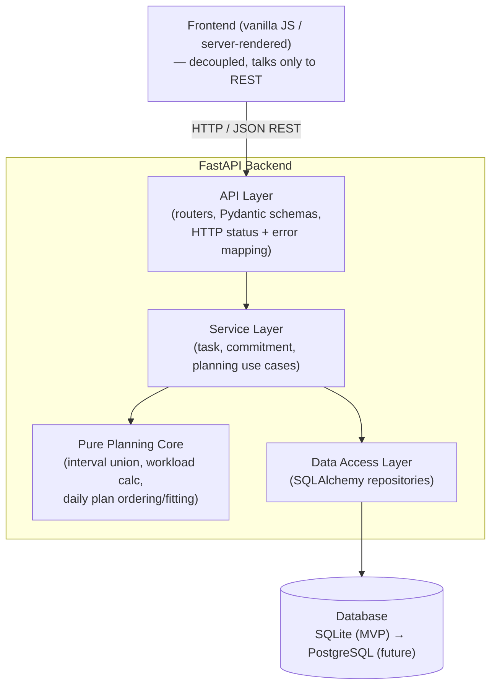

# FLOWLY MVP — Technical Design

## Overview

This document describes how the FLOWLY MVP will be built. It defines the architecture, technolog stack, data models, API surface, core planning logic, validation strategy, testing approach, and the extensibility seams that let the MVP grow into the larger vision without being rewritten.

The MVP is intentionally small. It serves a **single student** on their **local machine** with
**no authentication and no multi-user support** (both explicitly out of scope per
`docs/requirements.md` §15). It covers manual task management, manual commitments, a dashboard
(today / upcoming / workload / daily plan), and persistent storage.

The guiding principle is that the core planning logic that gives FLOWLY its value — the **workload
calculation** and the **daily planning algorithm** — are written as **pure functions**. They take
plain data in and return plain data out, with no database, clock, or network dependency. This makes
them deterministic, trivially unit-testable, and reusable as the product evolves.

### Scope boundaries (what this design deliberately does NOT include)

Per `docs/requirements.md` §15 and the staged vision in `docs/project_specificaton.md` §15, the
following are **not designed or built** here: Google Calendar, Canvas/LMS, email, transit,
SMS/push notifications, ML/AI scheduling, duration prediction, analytics, internship/application
tracking, multi-user accounts, and authentication/authorization. Section 13 (Future Extensibility)
explains how the MVP structure leaves room for these later — without implementing any of them now.

---

## 1. Design Goals and Principles

1. **Keep the MVP simple.** Build only what `docs/requirements.md` §14 lists. Resist adding future
   features early.
2. **Separate concerns into layers.** API handling, business logic, and data access are distinct so
   each can be developed and tested independently (`docs/requirements.md` §10).
3. **Planning logic is pure and deterministic.** Workload and daily-plan computations are pure
   functions of their inputs. No ML/AI (`docs/requirements.md` §8). The same inputs always produce
   the same output.
4. **Test the logic in isolation.** Because workload and plan logic are pure, they are tested
   directly with no DB or network. API behavior is tested with an in-process test client
   (`docs/requirements.md` §13).
5. **Decouple the frontend from the API.** The backend exposes a REST API that knows nothing about
   the UI. The frontend can be replaced (vanilla JS now, SPA later) without backend changes.
6. **Abstract persistence.** Use an ORM so the MVP can run on SQLite and later move to PostgreSQL by
   changing configuration, not code.
7. **Design for growth, build for now.** Every task and commitment carries a `source` field
   (`manual` for the MVP). Modular services and a stable REST contract are the seams future stages
   plug into (`docs/requirements.md` §10, §16).
8. **Validate at the boundary and fail cleanly.** Reject invalid input with clear, field-level
   messages and a consistent error shape. Never partially persist a rejected write
   (`docs/requirements.md` §11).

---

## 2. Recommended Technology Stack

The detailed tradeoff discussion already happened with the user; this is a concise record of the
confirmed choices and the main reason for each.

| Concern | Choice | Rationale / tradeoff (brief) |
|---|---|---|
| Backend | **Python + FastAPI** | Fast to build, async-capable, automatic OpenAPI docs, first-class Pydantic integration. Tradeoff: Python runtime vs. a compiled language — acceptable for a single-user planning app. |
| Validation / serialization | **Pydantic** | Declarative models give field-level validation and clean error output for free, and double as request/response schemas. |
| ORM | **SQLAlchemy** | Mature abstraction that decouples business logic from the specific database engine, enabling the SQLite→PostgreSQL swap. Tradeoff: more setup than raw SQL, repaid by portability and testability. |
| Database | **SQLite (MVP), swappable to PostgreSQL** | SQLite needs zero setup and is perfect for a single-user local MVP. The engine is selected by a connection URL in config, so moving to PostgreSQL later is a configuration change, not a rewrite. |
| API architecture | **REST** | Simple, well understood, and cleanly decouples frontend from backend. Resource-oriented endpoints map naturally to tasks and commitments. Tradeoff vs. GraphQL: less flexible querying, but far simpler for this scope. |
| Testing | **pytest + FastAPI `TestClient`** | pytest for fast pure-function unit tests of workload/plan logic; `TestClient` drives the API in-process (no network, no live server) for integration tests. |
| Frontend | **Decoupled; start with server-rendered / vanilla JS** | Keeps the MVP light and avoids a build toolchain. Because it only talks to the REST API, it can be replaced by React or another SPA later with no backend change. |

---

## Architecture

### 3. System Architecture

FLOWLY uses a classic three-layer backend. Each layer depends only on the layer below it, and the
pure planning logic sits beside the service layer with no downward dependencies at all.

- **API layer (routers):** Translates HTTP ⇄ Python. Parses and validates requests with Pydantic,
  calls a service, maps results and errors to HTTP responses and status codes. No business rules
  live here.
- **Service / business-logic layer:** Orchestrates use cases (create task, toggle completion, build
  today view, compute workload, generate daily plan). It calls the data-access layer for
  persistence and calls the **pure planning functions** for computation. This is where the MVP's
  behavior is defined.
- **Pure planning core:** Standalone, side-effect-free functions for interval union, workload
  calculation, and daily-plan ordering/fitting. Depend on nothing but their inputs.
- **Data-access layer (repositories):** Wraps SQLAlchemy. CRUD against the database behind simple
  method calls, so services never see SQL or sessions directly and the engine stays swappable.
- **Persistence:** SQLAlchemy over SQLite for the MVP (PostgreSQL later via config).



**Key boundary:** the Pure Planning Core has no arrow pointing down. It receives already-loaded
tasks and commitments (plus a target date / window) and returns results. That is what makes it
deterministic and testable without a database.

---

### 4. Project Structure

A modular layout that mirrors the layers. Each concern (tasks, commitments, planning) is isolated so
it can evolve independently (`docs/requirements.md` §10).

```
flowly/
├── app/
│   ├── main.py                  # FastAPI app creation, router registration
│   ├── config.py                # Settings incl. DATABASE_URL (SQLite now, PostgreSQL later)
│   │
│   ├── api/                     # API LAYER — HTTP only
│   │   ├── tasks.py             # Task CRUD + completion toggle endpoints
│   │   ├── commitments.py       # Commitment CRUD endpoints
│   │   ├── dashboard.py         # today / upcoming / workload / daily-plan endpoints
│   │   └── errors.py            # Exception handlers → consistent error response shape
│   │
│   ├── schemas/                 # Pydantic request/response models
│   │   ├── task.py              # TaskCreate, TaskUpdate, TaskRead
│   │   ├── commitment.py        # CommitmentCreate, CommitmentUpdate, CommitmentRead
│   │   └── dashboard.py         # WorkloadSummary, DailyPlan, TodayView, UpcomingView
│   │
│   ├── services/                # SERVICE / BUSINESS-LOGIC LAYER
│   │   ├── task_service.py
│   │   ├── commitment_service.py
│   │   └── dashboard_service.py # today/upcoming selection; calls planning core
│   │
│   ├── planning/                # PURE PLANNING CORE — no DB, no I/O
│   │   ├── intervals.py         # merge/union of time intervals
│   │   ├── workload.py          # available vs. estimated vs. difference
│   │   └── daily_plan.py        # deterministic ordering + time fitting
│   │
│   ├── data/                    # DATA ACCESS LAYER
│   │   ├── database.py          # SQLAlchemy engine/session factory from config
│   │   ├── models.py            # SQLAlchemy ORM models (Task, Commitment)
│   │   ├── task_repository.py
│   │   └── commitment_repository.py
│   │
│   └── domain/                  # Shared enums / plain domain types
│       └── enums.py             # Priority, Category, Completion, Source
│
├── frontend/                    # Decoupled UI (vanilla JS / static); replaceable later
│
└── tests/
    ├── unit/                    # Pure-function tests (workload, intervals, daily_plan)
    │   ├── test_intervals.py
    │   ├── test_workload.py
    │   └── test_daily_plan.py
    └── api/                     # TestClient integration tests
        ├── test_tasks_api.py
        ├── test_commitments_api.py
        └── test_dashboard_api.py
```

---

## Data Models

### 5. Data Model Definitions

Two entities: **Task** and **Commitment**. Each is defined at two levels — the SQLAlchemy ORM model
(persistence) and the Pydantic schemas (validation + API I/O). Fields, types, defaults, and
constraints below are authoritative.

### Enumerations (`app/domain/enums.py`)

| Enum | Values |
|---|---|
| `Priority` | `High`, `Medium`, `Low` |
| `Category` | `Academic`, `Work`, `Personal`, `Career` |
| `Completion` | `Incomplete`, `Complete` |
| `Source` | `manual` (only value in the MVP) |

### Task

| Field | Type | Default | Constraints / notes |
|---|---|---|---|
| `id` | integer | auto | Primary key, server-generated. |
| `title` | string | — (required) | Length 1–200 after trimming. Must not be empty/whitespace-only. |
| `description` | string | `""` (empty) | Optional. |
| `deadline` | datetime | `null` | Optional. Used by Today, Upcoming, and the daily plan. |
| `estimated_time` | integer (minutes) | `null` | Optional. If present, must be a **positive integer**. Treated as `0` in workload math when absent. |
| `priority` | `Priority` | `Medium` | One of High / Medium / Low (`docs/requirements.md` §2.5). |
| `category` | `Category` | `Personal` | One of Academic / Work / Personal / Career (`docs/requirements.md` §2.6). |
| `completion` | `Completion` | `Incomplete` | Toggled by the completion endpoint (`docs/requirements.md` §1.4). |
| `created_at` | datetime | now (server) | Set on creation; used as the final tiebreaker in daily-plan ordering. |
| `source` | `Source` | `manual` | Always `manual` in the MVP; a seam for future integrations (`docs/requirements.md` §10). |

### Commitment

| Field | Type | Default | Constraints / notes |
|---|---|---|---|
| `id` | integer | auto | Primary key, server-generated. |
| `title` | string | — (required) | Length 1–200 after trimming. Must not be empty/whitespace-only. |
| `start_time` | datetime | — (required) | Start of the occupied interval. |
| `end_time` | datetime | — (required) | Must be **strictly after** `start_time`. |
| `source` | `Source` | `manual` | Always `manual` in the MVP. |
| `created_at` | datetime | now (server) | Set on creation. |

**Validation ownership:** structural/field validation (lengths, enums, positivity, `end_time >
start_time`) lives in the Pydantic schemas so invalid input is rejected before any service or DB
work. See §10.

---

## Components and Interfaces

### 6. API Design

REST over JSON. All request bodies are validated by Pydantic; all responses are Pydantic-serialized.
Dates/times are ISO-8601 strings. Paths below are relative to the API root.

### Status code conventions

| Situation | Code |
|---|---|
| Successful read / update / toggle | `200 OK` |
| Successful create | `201 Created` |
| Successful delete | `204 No Content` |
| Validation failure (bad body/params) | `422 Unprocessable Entity` |
| Referenced task/commitment not found | `404 Not Found` |

### Tasks

| Method | Path | Request (body/params) | Success response | Codes |
|---|---|---|---|---|
| `POST` | `/tasks` | `TaskCreate` (title required; others optional) | `TaskRead` | 201 / 422 |
| `GET` | `/tasks` | optional filters | `TaskRead[]` | 200 |
| `GET` | `/tasks/{id}` | — | `TaskRead` | 200 / 404 |
| `PUT` | `/tasks/{id}` | `TaskUpdate` | `TaskRead` | 200 / 404 / 422 |
| `DELETE` | `/tasks/{id}` | — | — (empty) | 204 / 404 |
| `PATCH` | `/tasks/{id}/completion` | `{ "completion": "Complete" \| "Incomplete" }` | `TaskRead` | 200 / 404 / 422 |

The completion toggle is a dedicated endpoint (`docs/requirements.md` §1.4) so marking done/undone
is a first-class action, independent of general edits.

### Commitments

| Method | Path | Request | Success response | Codes |
|---|---|---|---|---|
| `POST` | `/commitments` | `CommitmentCreate` (title, start_time, end_time) | `CommitmentRead` | 201 / 422 |
| `GET` | `/commitments` | optional filters | `CommitmentRead[]` | 200 |
| `GET` | `/commitments/{id}` | — | `CommitmentRead` | 200 / 404 |
| `PUT` | `/commitments/{id}` | `CommitmentUpdate` | `CommitmentRead` | 200 / 404 / 422 |
| `DELETE` | `/commitments/{id}` | — | — (empty) | 204 / 404 |

### Dashboard

| Method | Path | Query | Success response | Codes |
|---|---|---|---|---|
| `GET` | `/dashboard/today` | `date` (optional, defaults to current date) | `TodayView` — incomplete tasks relevant to the date; completed stay distinguishable | 200 |
| `GET` | `/dashboard/upcoming` | optional range | `UpcomingView` — incomplete tasks with future deadlines, ordered clearly | 200 |
| `GET` | `/dashboard/workload` | `date` (optional) | `WorkloadSummary` (see §8) | 200 |
| `GET` | `/dashboard/daily-plan` | `date` (optional) | `DailyPlan` — ordered task list for the date (see §9) | 200 |

**Representative response shapes (high level):**

```jsonc
// WorkloadSummary
{
  "date": "2025-02-10",
  "window_minutes": 960,          // fixed 16-hour MVP window
  "committed_minutes": 180,       // union of commitment intervals on the date
  "available_minutes": 780,       // window - committed, clamped at >= 0
  "estimated_minutes": 300,       // sum of estimated_time of incomplete tasks due that date (missing => 0)
  "difference_minutes": 480,      // available - estimated
  "overloaded": false             // true when estimated strictly exceeds available
}
```

```jsonc
// DailyPlan
{
  "date": "2025-02-10",
  "available_minutes": 780,
  "planned_tasks": [
    { "id": 12, "title": "Finish lab report", "estimated_time": 120,
      "priority": "High", "deadline": "2025-02-10T23:59:00", "fits": true }
  ]
}
```

---

### 7. Task and Commitment Management Flow

A write request flows through the layers the same way every time, which keeps behavior predictable.

**Create / edit a task or commitment**
1. API layer receives the request and validates the body against the Pydantic schema. Invalid input
   is rejected immediately with `422` and field-level messages — nothing reaches the service or DB.
2. The valid, typed payload is handed to the service.
3. The service applies defaults where needed (`priority=Medium`, `category=Personal`,
   `completion=Incomplete`, `description=""`, `source=manual`, timestamps) and calls the repository.
4. The repository persists via SQLAlchemy in a single transaction; it either fully commits or rolls
   back (no partial writes).
5. The service returns the stored entity; the API serializes it to `TaskRead` / `CommitmentRead`
   with `201` (create) or `200` (edit).

**Complete / un-complete a task**
1. `PATCH /tasks/{id}/completion` with the target state.
2. Service loads the task (→ `404` if missing), sets `completion`, persists, returns the updated task.

**Delete**
1. Service checks existence (→ `404` if missing), the repository deletes, API returns `204`.

**Read / dashboard**
- Today / Upcoming: the dashboard service loads tasks via the repository, filters to the relevant
  set (incomplete; relevant to the date for Today, future-deadline for Upcoming), and returns them.
  Completed tasks remain distinguishable via their `completion` field (`docs/requirements.md` §5).
- Workload / Daily plan: the service loads the day's incomplete tasks and the relevant commitments,
  then delegates to the **pure planning core** (§8, §9) and returns the computed result.

---

### 8. Workload Calculation

Pure function in `app/planning/workload.py`. It depends only on its inputs (the target date, the
incomplete tasks due that date, and the commitments) — no clock, no DB.

**Inputs:** target `date`, list of incomplete tasks due on that date, list of commitments.

**Algorithm:**
1. **Window.** The daily planning window is a fixed **16 hours = 960 minutes**
   (`docs/requirements.md` §7). This is a stated temporary MVP assumption.
2. **Committed time (union, no double-counting).** Clip each commitment to the target date, then
   **merge overlapping/adjacent intervals into a union** and sum the union's length. Because the
   union is taken before summing, time covered by two overlapping commitments is counted **once**
   (`docs/requirements.md` §3.4).
3. **Available time.** `available = max(0, window - committed)`. Clamped so it is **never negative**
   (`docs/requirements.md` §7). If commitments meet or exceed the window, available is `0`.
4. **Estimated time.** Sum `estimated_time` over the incomplete tasks due that date. A task with a
   **missing `estimated_time` contributes 0** (`docs/requirements.md` §2.4).
5. **Difference.** `difference = available - estimated`. This value may be negative; it is reported
   as-is (only *available* is clamped, never the difference).
6. **Overload flag.** `overloaded = estimated > available` (strict). True exactly when estimated
   work cannot fit in available time.

**Interval union detail:** sort intervals by start; walk left to right; if the next interval starts
at or before the current merged interval's end, extend the end; otherwise close the current interval
and begin a new one. Sum `(end - start)` across merged intervals. This handles overlaps, nesting,
and back-to-back commitments correctly.

**Output:** `window_minutes`, `committed_minutes`, `available_minutes`, `estimated_minutes`,
`difference_minutes`, `overloaded` (matches the `WorkloadSummary` shape in §6).

---

### 9. Daily Planning Algorithm

Pure, **deterministic** function in `app/planning/daily_plan.py`. No ML/AI (`docs/requirements.md`
§8). Same inputs always yield the same ordered plan.

**Inputs:** target `date`, incomplete tasks, available minutes (from §8).

**Step 1 — Candidate selection.** Include an incomplete task only if it has a **defined deadline on
or before** the target date. **Tasks with no deadline are excluded** from the plan entirely
(`docs/requirements.md` §8).

**Step 2 — Deterministic ordering.** Sort candidates by a strict, total comparison:
1. **Deadline ascending** (earlier deadline first).
2. **Priority** High > Medium > Low.
3. **`created_at` ascending** (earlier creation first).

This three-level key makes ordering fully determined and reproducible.

**Step 3 — Fitting into available time.** Walk the ordered list, accumulating `estimated_time`.
Each task is marked with whether it fits within the remaining available time (a task with missing
`estimated_time` consumes 0). The plan reports the ordered tasks and their fit so the student can
see where the day runs out of time. The ordering itself never changes based on fit — fit is an
annotation layered on top of the deterministic order.

**Output:** `DailyPlan` (ordered `planned_tasks` with fit flags and the available minutes), matching
the shape in §6.

---

## Correctness Properties

*A property is a characteristic or behavior that should hold true across all valid executions of a
system — essentially, a formal statement about what the system should do. Properties serve as the
bridge between human-readable specifications and machine-verifiable correctness guarantees.*

The properties below cover the testable acceptance criteria from `docs/requirements.md`. Pure
planning logic (workload, intervals, daily plan) is especially well suited to property-based testing
because it is deterministic and operates over a large input space. CRUD properties are expressed as
round-trips and invariants exercised through the service/API.

### Property 1: Task creation round-trip with defaults

*For any* valid task input (title of length 1–200, with any combination of optional fields), after
creation the stored task is retrievable and carries exactly the provided values, with unspecified
fields set to their defaults (`description=""`, `priority=Medium`, `category=Personal`,
`completion=Incomplete`, `source=manual`).

**Validates: Requirements 1.1, 2.2, 2.5, 2.6, 10 (source=manual)**

### Property 2: Task edit reflects updates

*For any* existing task and *any* valid update, after editing, the retrieved task reflects the
updated field values and no non-updated field is altered.

**Validates: Requirements 1.2**

### Property 3: Delete removes the task

*For any* existing task, after deletion the task is absent from storage and a subsequent lookup
reports not-found.

**Validates: Requirements 1.3**

### Property 4: Completion toggle round-trip

*For any* task, setting completion to `Complete` and then back to `Incomplete` restores the task to
its original completion state, and each set persists.

**Validates: Requirements 1.4**

### Property 5: Title validation rejects empty/whitespace/over-length, with no persistence

*For any* candidate title that is empty, whitespace-only, or longer than 200 characters, task
creation is rejected and the task store is left unchanged.

**Validates: Requirements 2.1, 10 (no partial persistence)**

### Property 6: Estimated-time validation

*For any* provided `estimated_time` that is not a positive integer, creation is rejected; when
`estimated_time` is omitted, creation succeeds.

**Validates: Requirements 2.4**

### Property 7: Commitment creation round-trip with end-after-start validation

*For any* commitment input with a valid title and `end_time` strictly after `start_time`, the stored
commitment is retrievable with matching fields and `source=manual`; *for any* input where `end_time`
is not strictly after `start_time`, creation is rejected and nothing is persisted.

**Validates: Requirements 3.1, 10 (source=manual, no partial persistence)**

### Property 8: Commitment edit and delete

*For any* existing commitment, a valid edit yields a retrieved commitment reflecting the changes, and
a delete leaves the commitment absent from storage.

**Validates: Requirements 3.2, 3.3**

### Property 9: Committed time is the union of intervals (no double-counting)

*For any* set of commitments on a date, the computed committed minutes equal the total length of the
**union** of their intervals; this value never exceeds the sum of the individual interval lengths
and never exceeds the 960-minute window, regardless of overlaps, nesting, or adjacency.

**Validates: Requirements 3.4**

### Property 10: Available time is clamped and never negative

*For any* set of commitments, `available_minutes = max(0, 960 - committed_minutes)`, and the result
is always greater than or equal to 0 — including when commitments meet or exceed the window.

**Validates: Requirements 7**

### Property 11: Estimated minutes sum treats missing estimates as zero

*For any* set of incomplete tasks due on a date, the computed estimated minutes equal the sum of
their `estimated_time` values, counting any task with a missing `estimated_time` as 0.

**Validates: Requirements 2.4, 7**

### Property 12: Overload flag matches strict comparison

*For any* workload inputs, the `overloaded` flag is true if and only if estimated minutes strictly
exceed available minutes.

**Validates: Requirements 7**

### Property 13: Daily-plan candidate selection

*For any* set of tasks, the daily plan for a target date includes exactly those tasks that are
incomplete and have a defined deadline on or before the target date; tasks with no deadline are
never included.

**Validates: Requirements 8**

### Property 14: Daily-plan deterministic ordering

*For any* set of candidate tasks, in the produced plan every adjacent pair is ordered by deadline
ascending, then by priority (High > Medium > Low), then by `created_at` ascending.

**Validates: Requirements 8**

### Property 15: Daily plan is deterministic

*For any* set of inputs, generating the daily plan twice produces identical output (no ML/AI, no
nondeterminism).

**Validates: Requirements 8**

### Property 16: Daily-plan fitting respects available time

*For any* ordered candidate list and available minutes, the cumulative `estimated_time` of the tasks
marked as fitting does not exceed the available minutes, where a task with a missing `estimated_time`
consumes 0.

**Validates: Requirements 8**

### Property 17: Today view selection

*For any* set of tasks, the Today view contains only incomplete tasks relevant to the target date
and never contains completed tasks, while completed tasks remain distinguishable by their completion
state elsewhere.

**Validates: Requirements 5**

### Property 18: Upcoming view selection and ordering

*For any* set of tasks, the Upcoming view contains only incomplete tasks with future deadlines, and
the result is ordered consistently (by deadline ascending).

**Validates: Requirements 6**

---

## Error Handling

Validation and errors are handled at the boundary with a single, consistent shape so the frontend
can always parse failures the same way.

**Validation (Pydantic):** All request bodies and query params are validated by Pydantic schemas
before any service runs. Field constraints enforced here include: `title` length 1–200 and
non-empty-after-trim; `estimated_time` a positive integer when present; `priority`/`category`
restricted to their enums; and `end_time` strictly after `start_time` for commitments. A validation
failure returns `422` with **field-level** detail identifying which field failed and why.

**No partial persistence:** Because validation runs before the service layer and each write happens
in a single transaction, a rejected request never leaves a partially written row. If a transaction
fails mid-way, it rolls back entirely.

**Not found:** When a request references a task or commitment id that does not exist, the service
raises a not-found condition that the API maps to `404`.

**Consistent error response shape:** All errors (validation and not-found) are serialized to a
single envelope so clients handle them uniformly:

```jsonc
{
  "error": {
    "type": "validation_error",          // or "not_found"
    "message": "Request validation failed",
    "details": [
      { "field": "title", "issue": "must be between 1 and 200 characters" }
    ]
  }
}
```

A centralized exception handler (`app/api/errors.py`) produces this envelope for every error path,
so no endpoint invents its own format.

---

## Testing Strategy

Testing follows a **dual approach** (`docs/requirements.md` §13): property-based tests for the pure
planning logic, and example/integration tests for API behavior and persistence. All tests run
**without external network access** — the API is exercised in-process with FastAPI `TestClient`, and
the MVP database is SQLite (an in-memory or temporary file database is used for tests).

### Property-based tests (pure logic)

PBT is appropriate here because the workload and daily-plan functions are pure, deterministic, and
operate over a large input space where generated inputs reveal edge cases (overlapping commitments,
missing estimates, mixed deadlines).

- **Library:** `hypothesis` (the standard property-based testing library for Python). We will not
  implement property testing from scratch.
- **Iterations:** each property test runs a **minimum of 100 iterations**.
- **Tagging:** each property test references its design property with a comment in the form
  **`Feature: flowly-mvp, Property {number}: {property_text}`**.
- **Mapping:** Properties 9–16 map directly onto the pure functions in `app/planning/`
  (`intervals.py`, `workload.py`, `daily_plan.py`). Properties 1–8, 17, 18 are exercised through the
  service/API layer with generated inputs where practical.

Generators will deliberately produce edge cases: empty commitment sets, overlapping/nested/adjacent
intervals, commitments exceeding the 960-minute window, tasks with and without deadlines, tasks with
and without `estimated_time`, and mixes of complete/incomplete tasks
(`docs/requirements.md` §13: tasks with/without deadlines, overlapping commitments).

### Unit tests (specific examples / edge cases)

Focused example-based tests for concrete scenarios and boundaries that complement the properties:
exact boundary titles (length 1 and 200), `estimated_time` of exactly 1 vs. 0 vs. negative,
a commitment exactly equal to the full window (available = 0), and a plan where available time runs
out partway through the ordered list.

### API / integration tests (FastAPI `TestClient`)

Example-based tests covering end-to-end request/response behavior:
- Task CRUD + completion toggle happy paths and status codes (`201`/`200`/`204`).
- Commitment CRUD happy paths and status codes.
- Dashboard endpoints (today, upcoming, workload, daily-plan) return the documented shapes.
- Not-found handling returns `404` for each `GET`/`PUT`/`DELETE`/`PATCH` on a missing id (per
  Property-adjacent example tests for Requirement 10).
- Validation failures return `422` with the consistent error envelope and field-level detail.
- **Persistence** (`docs/requirements.md` §9): create via the API, read back through a fresh session,
  and assert the data survived.

### Coverage against Requirements §13

The suite covers, at minimum: creating/editing/deleting/completing tasks, creating and managing
commitments, workload calculations, daily-plan prioritization, tasks with and without deadlines, and
overlapping commitments — all without external network dependencies.

---

## Security and Privacy Considerations

The MVP is a **single-user, local application with no authentication and no authorization** —
multi-user accounts and auth are explicitly out of scope (`docs/requirements.md` §15). This design
therefore **does not implement any authentication, authorization, session, or user-identity
mechanism**, and no such mechanism should be added as part of the MVP.

What the MVP does provide:

- **Input validation at the boundary.** Every write is validated by Pydantic before processing,
  which rejects malformed or out-of-range input and reduces the risk of bad data entering storage.
- **Parameterized persistence.** SQLAlchemy uses parameterized queries, avoiding SQL injection by
  construction. No raw string-built SQL.
- **Local-only data.** Data lives in a local SQLite file; nothing is transmitted to external
  services (consistent with the MVP having no integrations).

**Privacy note (future-only):** The privacy and user-control principles in
`docs/project_specificaton.md` §13 — least-privilege permissions, user control over connected
services, clear communication of data use, and the ability to disconnect integrations — apply to
**future external integrations** (calendar, LMS, email, transit). They are recorded here as design
intent for later stages and are **not implemented in the MVP**, because the MVP has no external
integrations and no personal-account access.

---

## Future Extensibility

The MVP is built so the staged vision in `docs/project_specificaton.md` §15 can be added later
**without rewriting existing functionality** (`docs/requirements.md` §16). The following seams exist
in the design but are deliberately left unimplemented:

- **The `source` field.** Every task and commitment carries `source`, fixed to `manual` in the MVP.
  Future stages can introduce additional source values (e.g., calendar-, LMS-, or email-originated)
  so externally imported items coexist with manual ones under the **same data structures**
  (`docs/requirements.md` §10). No schema redesign is needed to attribute an item to an integration.
- **Modular service separation.** Task, commitment, and dashboard/planning responsibilities are
  isolated services, and the planning logic is pure. A future **ingestion/integration service**
  (Stages 2–5: Calendar, Canvas, Email, Transit) can create tasks/commitments through the same
  service interfaces without touching the planning core. A future **intelligent-planning module**
  (Stage 7, ML) can be introduced as an alternative to — or a layer above — the deterministic
  `daily_plan` function, swapping planning strategies behind the service boundary.
- **Decoupled REST API.** Because the frontend only consumes REST and the API carries no UI
  assumptions, the vanilla-JS frontend can be replaced by an SPA, and new clients (e.g., a future
  notifications surface, Stage 6) can be added, with no backend change.
- **SQLAlchemy database abstraction.** The engine is chosen by `DATABASE_URL` in config, so moving
  from SQLite to PostgreSQL (needed as data and, eventually, integrations grow) is a configuration
  change rather than a code rewrite.

Mapping to the spec's staged direction (`docs/project_specificaton.md` §15): Stage 1 is this MVP.
Stages 2–5 (Calendar, Academic/Canvas, Email, Transit) plug in via new ingestion services that emit
`source`-tagged tasks/commitments. Stage 6 (Notifications) and Stage 8 (assistant) attach as new
clients/services on the stable REST contract. Stage 7 (Intelligent Planning / ML) replaces or
augments the deterministic planner behind the planning service boundary.

**None of these future capabilities are designed or built in this document** — they are called out
only to show that the MVP's structure accommodates them when their respective stages begin.

